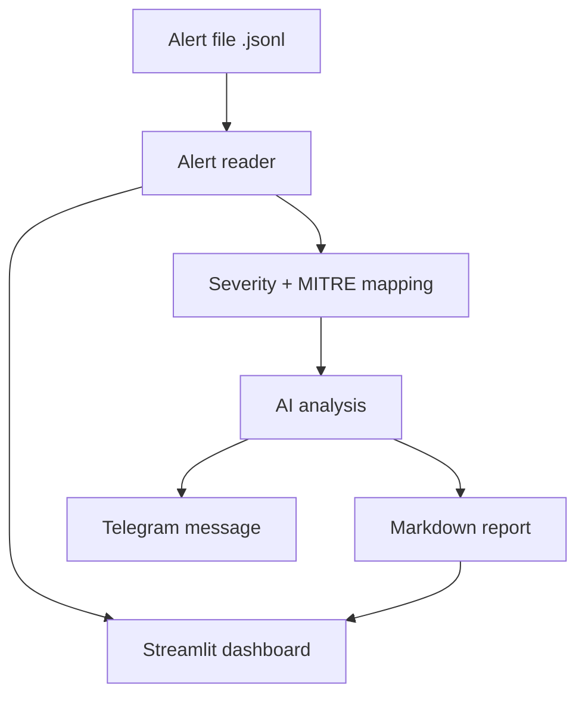
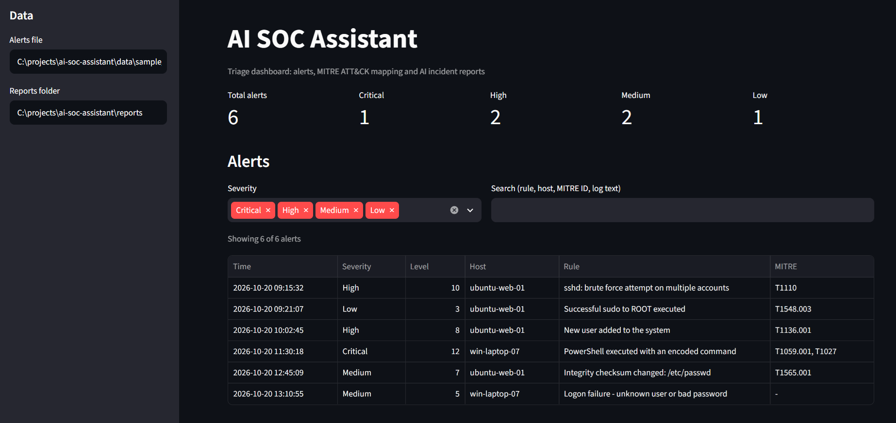
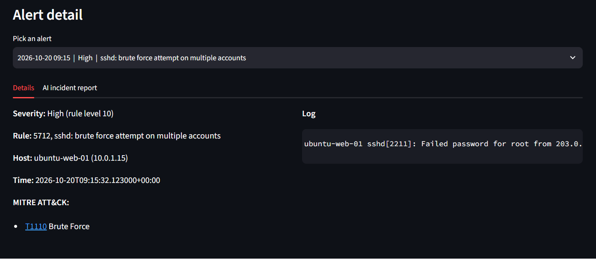

# AI SOC Assistant

An AI-assisted SOC triage tool. It reads security alerts, maps them to MITRE ATT&CK, asks an AI model what each alert means and what to check next, writes an incident report, and can send a Telegram message for serious alerts. A Streamlit dashboard shows everything in one place.

> **Credit:** This project is a learning rebuild based on
> [mags-mags-soc/ai-soc-assistant](https://github.com/mags-mags-soc/ai-soc-assistant)
> by Magsud Magsudlu (MIT licensed). The original design and ideas are his.
> This repository is my own step-by-step reimplementation, built to learn how
> a SOC triage pipeline works. It uses sample alerts instead of a live Wazuh
> lab.

---

## Features

- Reads Wazuh-style alerts (JSON Lines) and validates every one with Pydantic
- Severity labels (Low, Medium, High, Critical) from the rule level
- MITRE ATT&CK technique links for each alert
- AI assessment per alert: summary, risk level, confidence, likely false positive, investigation steps
- Works with any OpenAI-compatible AI service (tested with Google Gemini); a mock AI is used for tests and offline runs
- Markdown incident reports, one per alert
- Telegram notifications for High and Critical alerts (optional)
- Pipeline that remembers processed alerts, so reruns never repeat (or re-bill) work
- Streamlit dashboard with filters, search, MITRE links and the AI report for each alert
- 126 automated tests

## How it works



## Quick start (Windows PowerShell)

```powershell
git clone https://github.com/jinu-18080506/ai-soc-assistant.git
cd ai-soc-assistant
python -m venv .venv
.venv\Scripts\activate
pip install -r requirements-dashboard.txt
```

Python 3.11 or newer is needed.

Run it with the mock AI (no key needed):

```powershell
python main.py --mock --dry-run
python main.py --mock
```

Open the dashboard:

```powershell
streamlit run dashboard/app.py
```

Your browser opens at http://localhost:8501.

## Using a real AI

1. Create a free key in Google AI Studio.
2. Copy `.env.example` to `.env` and fill in `AI_API_KEY`.
3. Run `python main.py --list-models` and put a plain Flash model name in `AI_MODEL`.
4. Run `python main.py`.

`.env` is listed in `.gitignore`, so your keys are never committed.

## Telegram notifications (optional)

1. Create a bot with @BotFather in Telegram and put its token in `.env` as `TELEGRAM_BOT_TOKEN`.
2. Send any message to your bot, then run `python main.py --telegram-find-chat` and put the number in `.env` as `TELEGRAM_CHAT_ID`.
3. Check it with `python main.py --notify-test`.
4. Run `python main.py --notify`. Alerts at or above `NOTIFY_MIN_LEVEL` (default 8) are sent.

## Command reference

| Command | What it does |
|---------|--------------|
| `python main.py --dry-run` | Show what would be processed, change nothing |
| `python main.py --limit 2` | Process at most 2 new alerts |
| `python main.py --min-level 8` | Only alerts at level 8 or above |
| `python main.py --mock` | Use the fake AI |
| `python main.py --notify` | Also send Telegram messages |
| `python main.py --list-models` | List the AI models your key can use |

Exit code is 0 on success, 1 if any alert failed, 2 if a setting is missing.

## Project structure

```text
ai-soc-assistant/
├── backend/src/soc/
│   ├── ai/            AI schemas, mock client, real client, analyzer
│   ├── notify/        message format, Telegram client
│   ├── report/        Markdown incident reports
│   ├── alert_reader.py  config.py  mitre.py  models.py
│   ├── pipeline.py    severity.py  state.py
├── dashboard/         Streamlit dashboard (app.py, data.py)
├── data/              sample alerts
├── docs/sample_reports/  example reports written by the real AI
├── tests/             126 tests
├── main.py            command-line entry point
└── requirements*.txt
```

## Testing

```powershell
pip install -r requirements-dev.txt
python -m pytest
```

## Security notes

- Log text is untrusted. The AI prompt tells the model to treat it as data only, and the text is cut to 1000 characters.
- Reports put log text in a code fence that the log itself cannot close.
- API keys and the Telegram token never appear in error messages or logs.
- Telegram messages are plain text and leave out the raw log.
- A free AI tier may log prompts, so only the fake sample alerts are used here. Do not send real company alerts to a free tier.

## Build plan

- [x] Alert model and reader
- [x] Severity and MITRE ATT&CK mapping
- [x] AI threat analysis with structured output
- [x] Markdown incident reports
- [x] Notifications (Telegram)
- [x] Pipeline entry point (`main.py`)
- [x] Streamlit dashboard

Possible next steps: read live alerts from a Wazuh server, group related alerts, and look up IP addresses in a threat-intelligence service.

## Screenshots




## License

MIT License. See [LICENSE](LICENSE). The original copyright notice from
Magsud Magsudlu is kept alongside mine, as the MIT license requires.

## Author

**Jinu G Mathew**: AWS and cybersecurity student, building towards a SOC analyst role.
