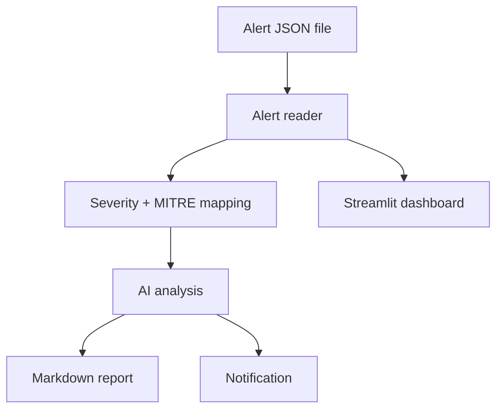

# AI SOC Assistant

An AI-assisted SOC triage project: it reads security alerts, maps them to MITRE ATT&CK, asks an AI model what the alert means and what to do next, and writes an incident report.

> **Credit:** This project is a learning rebuild based on
> [mags-mags-soc/ai-soc-assistant](https://github.com/mags-mags-soc/ai-soc-assistant)
> by Magsud Magsudlu (MIT licensed). The original design and ideas are his.
> This repository is my own step-by-step reimplementation, built to learn how
> a SOC triage pipeline works.

---

## Status

Work in progress. Features are added one stage at a time and checked off below.

## Build plan

- [ ] Alert model and reader (load Wazuh-style alerts from JSON)
- [ ] Severity and MITRE ATT&CK mapping
- [ ] AI threat analysis with structured output
- [ ] Markdown incident reports
- [ ] Notifications (Telegram / email)
- [ ] Pipeline entry point (`main.py`)
- [ ] Streamlit dashboard

## Planned architecture



## Planned project structure

```text
ai-soc-assistant/
├── backend/src/soc/    core package (reader, models, AI, reports)
├── dashboard/          Streamlit dashboard
├── tests/              automated tests
├── docs/               notes and screenshots
├── main.py             pipeline entry point
├── requirements.txt
├── LICENSE
└── README.md
```

## Technology

| Category | Technology |
|----------|------------|
| Language | Python 3.11+ |
| Validation | Pydantic |
| AI | OpenAI-compatible API |
| Dashboard | Streamlit |
| Testing | Pytest |
| Version control | Git / GitHub |

## Installation

```bash
git clone https://github.com/jinu-18080506/ai-soc-assistant.git
cd ai-soc-assistant
python -m venv .venv
.venv\Scripts\activate
pip install -r requirements.txt
```

(Requirements will be added as the code is built.)

## What I'm learning

- Reading and normalising SIEM alerts
- Mapping alerts to MITRE ATT&CK
- Using an AI model for structured alert triage
- Writing incident reports
- Structuring a Python project with tests and Git

## License

MIT License. See [LICENSE](LICENSE). The original copyright notice from
Magsud Magsudlu is kept alongside mine, as the MIT license requires.

## Author

**Jinu G Mathew**: AWS and cybersecurity student, building towards a SOC analyst role.